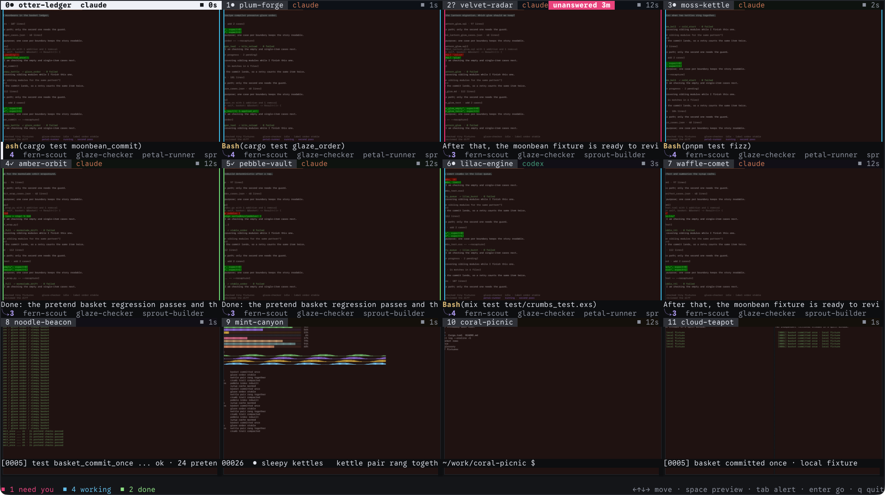
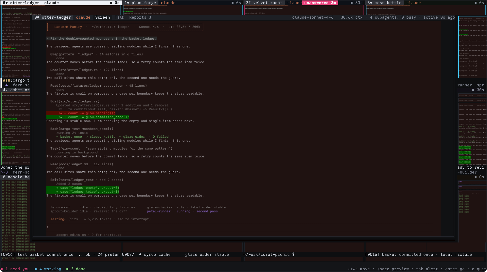
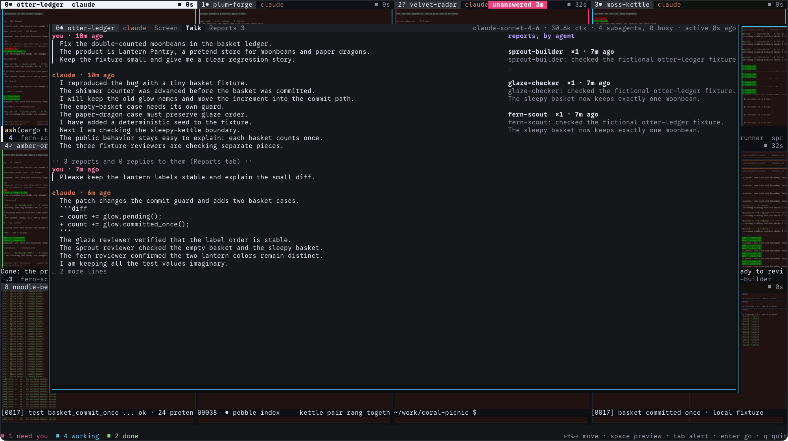

## Hello, human

I made this to keep track of a lot of coding agents running in tmux at once. Bugs in tmux itself limit it, and I stopped short of working around them. It works well otherwise, but expect to put in some time of your own.

---

*The rest of this README was written by an AI model (Claude Opus 5.5) from the code in this repository.*

### Why this is public

ncm is personal software. I built it with AI coding agents for my own use: watching six to sixteen coding agents and their subagents on one screen, so I can catch them doing dumb things. Take what's useful. It's unsupported, and I'm not promising fixes.

---

# ncm

ncm is a full-screen terminal app that shows every window of a tmux session as a live picture card,
for watching many terminal sessions or coding agents at once. It normally runs directly in a Ghostty
window while the agents keep running in a background tmux server. A floating Quick Look panel shows
a larger live picture of one window, the conversation with the Claude Code or Codex agent in it, and
its subagent reports. Enter attaches a real tmux client to that window; Ctrl-] returns to the wall.

tmux stays the source of truth for windows, panes, order and alerts. ncm mirrors it and changes
nothing in tmux except on an explicit key or click.

**Status:** working prototype, parked on 2026-10-04. Known bugs and the plan to fix them are in
[docs/PARKED.md](docs/PARKED.md).

## What it looks like

All screenshots come from the fictional demo world in [`scripts/demo/`](scripts/demo/README.md):
a private tmux server with nonsense window names and fake agents. No real harness is running.

**The wall.** Every window is a live picture card. The header shows the index, a state mark
(`●` working, `✓` done, `?` needs the user), the name and the harness. A pink `unanswered 3m` badge
marks a window where the user's last message to the agent has had no reply for more than 20
seconds. Each card's footer shows the latest tool call or reply and the subagents. The dock counts
need you / working / done. Header strips are tinted by tmux section.



**Quick Look: Screen.** Space or a click opens a large live picture of the window. The facts row
shows the model, context size, subagents and last activity.



**Quick Look: Talk.** The user's messages and the agent's replies, read from the transcript and
nothing else. Long replies fold (`… 2 more lines`), and runs of subagent reports collapse into one
line. The right column groups the latest reports by agent; a Reports tab lists them in full. When the
user's last message has no reply, a banner appears here.



**Full screen.** Enter, `i` or a click inside Quick Look attaches a real tmux client to that
window, with the user's own bindings, mouse and copy mode. Ctrl-] or prefix-d returns to ncm.

![Full-screen tmux with C-] back](docs/screenshots/07-fullscreen.png)

## Features

- **Live pictures of whole windows.** Each card shows every pane at its real layout, with borders,
  colors and tmux tints, cropped so the newest output at the bottom stays visible. Glyphs are drawn
  at thumbnail size from Ghostty's configured font (then SF Mono, then Menlo). Card text such as
  titles, badges and the now line is ordinary terminal text over the picture, so it stays sharp and
  changing it sends no image data.
- **Mirrors tmux, keeps nothing of its own.** Order follows the status bar's sections, then window
  index. Renames, splits, moves and new or closed windows show up within about a second.
- **Attention that doesn't fade.** Card edges take the window's state (needs, bell, working, done,
  activity). Tab jumps to the next alert in that order. The needs/working/done states come from an
  `@agent_state` window option set by external hooks, which aren't part of this repo.
- **Talk without hooks.** ncm finds each pane's Claude Code or Codex process, locates the transcript
  that process owns, and follows it read-only. It separates the user's messages from subagent and
  task reports, tracks unanswered messages, and pulls the model, context size, current tool and
  subagents from the transcript, falling back to reading the screen. When ownership is ambiguous,
  as in a supervisor pane with several agents, it shows Screen only instead of guessing.
- **Real tmux on demand.** Full screen creates a temporary grouped session (`_ncm_view_<pid>`) and
  attaches to it on the same terminal, so the source session's current window and other clients are
  untouched. The helper session is removed on detach, exit or failure, and ncm redraws everything
  on return.
- **Window actions:** `,` rename, `x` close (asks y/n), `n` new window, or the right-click menu.
  `--read-only` disables every action.
- **Works over SSH.** `ssh -t <host> ~/.local/bin/ncm` from a plain terminal tab. tmux is found
  without an interactive shell `PATH`.
- **Text fallback.** Terminals that don't answer the kitty graphics query within five seconds get
  braille/text thumbnails, with the reason in the dock. Inside tmux, ncm always uses braille/text
  and selects windows instead of attaching.
- **Diagnostics:** `--list` prints the windows, `--diagnose-talk` shows which transcript each pane
  maps to (without message bodies), `--stats` puts ncm's CPU, memory and image traffic in the dock,
  and `--demo` shows synthetic windows with no tmux server.

## Requirements

- Rust 1.91 or newer to build. The repo's `.cargo/config.toml` limits builds to one job.
- tmux. The docs record testing against tmux 3.7.
- macOS. Process discovery uses libproc and the font lookup searches macOS font folders. Linux code
  paths exist for process discovery, but no Linux run is recorded.
- For pictures, a terminal with the kitty graphics protocol and Unicode placeholders. It was checked
  by eye in Ghostty.
- For Talk, Claude Code or Codex in the panes. Other agents get Screen and screen-derived facts.

## Install and run

```sh
cargo build --release
mkdir -p ~/.local/bin
install -m 755 target/release/ncm ~/.local/bin/ncm

ncm                          # mirror session "main" of the default tmux server
ncm --session NAME           # another session
ncm --socket PATH            # another server (also NCM_TMUX_SOCKET)
ssh -t <host> ~/.local/bin/ncm
```

There is no prebuilt download yet. Build it as above, or have your agent do it.

To try it on the demo world:

```sh
scripts/demo/up.sh     # starts a private tmux server and prints the ncm command to run
# paste the printed command into a Ghostty window (200x55 fits best)
scripts/demo/down.sh   # stops it; nothing outside target/demo/ is touched
```

## Main keys

Arrows move between cards (in Quick Look, Left/Right change window and Up/Down scroll). Space opens
or closes Quick Look; `1`, `2`, `3` pick Screen, Talk or Reports; `[` and `]` pick the pane Talk
follows. Enter or `i` goes full screen; Ctrl-] or prefix-d comes back. Tab jumps to the next
alert. Esc closes Quick Look and never quits; `q` quits. `ncm --help` lists the rest.

## How it works

The workspace has six crates: `ncm-tmux` (tmux queries, capture, actions), `ncm-term` (parses
`capture-pane` output and composes panes), `ncm-render` (glyph atlas, thumbnails, kitty encoder,
braille fallback), `ncm-talk` (process discovery and transcript adapters), `ncm-model` (shared
types) and the `ncm` app.

One persistent tmux control client carries every read. It only accepts queries and captures, and
its output notifications tell ncm which panes changed. Cards recapture at most once per second,
the Quick Look window every 250 ms, and identical captures are skipped. Pictures go straight to the
terminal as kitty images, uploaded in changed strips under a paced byte budget, with text frames
taking priority. Output is synchronized and diffed, so an idle wall writes nothing.
[docs/CONTROL-MODE.md](docs/CONTROL-MODE.md) records about 1.2% of one core for ncm on a live
server; [docs/INTEGRATION.md](docs/INTEGRATION.md) has more measurements.

## Data and privacy

- Reads tmux state, the process table, Claude Code and Codex transcripts (in place, never copied;
  thinking, images and tool output are skipped), Ghostty's config and an optional section group
  file.
- Writes only `~/.local/state/ncm/panic.log` after a crash, plus a `--log FILE` if given.
- The control client counts as an attached tmux client, so attach/detach hooks can run. Full screen
  adds a root `C-]` binding to the tmux server that passes the key through in other sessions and
  stays after ncm exits.
- No network use.

## Limitations

- The five bugs in [docs/PARKED.md](docs/PARKED.md): busy cards repaint in bands; slices beside
  Quick Look and the menu are wrong; the menu opens mid-screen; returning from full screen lands on
  Quick Look instead of the grid; and full screen shows the helper session's name. A fix was in
  progress when the project was parked and isn't in this repo.
- Every window gets an equal card, so large sessions mean small cards.
- Pictures only work outside tmux.
- Talk exists only for Claude Code and Codex, and Claude `/clear` and in-process `/resume` haven't
  been fully verified.
- tmux is looked up first at a hard-coded path in the author's home directory, then in Homebrew,
  then on `PATH`.
- `scripts/check.sh` runs through an admission script on the author's machine, so it fails
  elsewhere as written.

## Keywords

tmux, tmux dashboard, tmux window overview, terminal multiplexer, live terminal thumbnails, kitty
graphics protocol, Unicode placeholders, Ghostty, braille rendering, tmux control mode, Claude Code,
OpenAI Codex, coding agents, AI agent monitoring, multi-agent orchestration, subagents, agent
transcripts, Quick Look preview, TUI, Rust, macOS, SSH
